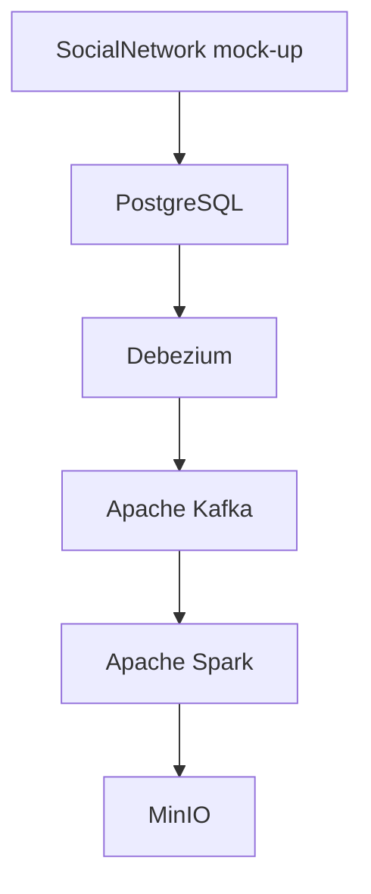

# Mini data platform

The objective of the project is to develop a mini data platform using containers that 
simulates a business process, ingests data into PostgreSQL, captures changes with 
Debezium, streams data through Kafka, processes it in Spark and stores it in MinIO in 
Delta format.

## Social Network stub and data pipeline

The Social Network stub simulates a social media platform by continuously generating
business events for users, posts, follows, ratings, and comments. It inserts these
records into PostgreSQL at a configurable rate, while respecting relationships
between users and posts. A FastAPI control endpoint allows the event rate to be
changed at runtime or paused.

PostgreSQL is the transactional source of truth. Debezium captures database changes
and publishes them to Kafka, where the event stream is consumed and transformed by
Spark. Spark writes the processed data to MinIO in Delta format for analytical
storage and further processing.

## Platform structure 



## Running

The platform can be started with Docker or Podman (below as `cprovider`):

```bash
cp .env.example .env
cprovider compose up --build -d
```

The Social Network stub is available at <http://localhost:8000>. To follow the
service logs or stop the platform:

```bash
cprovider compose logs -f socnet-stub
cprovider compose down
```
